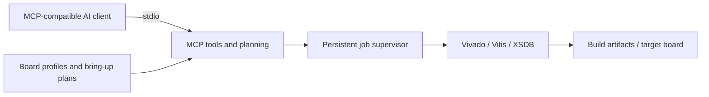

> Creator: whjeong<br>
> Created on: 2026-10-13<br>
> https://maduinos.blogspot.com/

# AMD FPGA MCP

**Connect an MCP-compatible AI assistant to AMD/Xilinx FPGA development workflows.** Inspect projects and toolchains, prepare build plans, run vendor tools, review timing and quality reports, and track guarded hardware operations through one structured interface.

This is independent community software, not an official AMD product. AMD tools and licenses are installed separately.

[Download releases](https://github.com/maduinos/amd-fpga-mcp-releases/releases/latest) · [Visual overview](https://maduinos.github.io/amd-fpga-mcp-releases/) · [Report an issue](https://github.com/maduinos/amd-fpga-mcp-releases/issues)

This README is the main installation and usage guide. Release automation instructions are in the [maintainer guide](docs/MAINTAINERS.md).

## What can it do?

The 0.7.1 package exposes **96 annotated MCP tools**.

| Area | Capabilities |
| --- | --- |
| Environment and projects | Inspect toolchains, probe runtime readiness, discover projects and inspect XSA/ELF compatibility. |
| Vivado | Plan and execute builds, create/edit block designs, inspect artifacts and review implementation reports. |
| Timing and quality | Analyze checkpoints, timing/CDC/DRC and resources; create and compare optimization candidates. Timing closure is not guaranteed. |
| Vitis and IP | Plan platforms and applications, bare-metal/RTOS workflows, HLS stages and verified RTL IP packaging. |
| Hardware | Inspect target identity, initialize supported PS flows, deploy artifacts and capture UART; boot/storage workflows depend on the target and prerequisites. |
| Board bring-up | Load board profiles and generate board constraints, schematic manifests and bring-up checklists. A bring-up plan does not execute hardware commands. |
| Jobs and evidence | Track asynchronous jobs, inspect logs, cancel jobs, preserve state and verify artifact hashes. |



## Supported environments

| Host | Distribution | Requirements and scope |
| --- | --- | --- |
| Linux x86_64 | `.tar.gz` | Python 3.12 and its venv module. Ubuntu 24.04 is the documented installation path. |
| Windows x86_64 | `.zip` | PowerShell plus Ubuntu 24.04 on **WSL2**. The MCP server runs inside Linux. |
| Native Windows Python | None | **Not supported in the current release.** |

Both downloads contain the same Linux backend and offline Python dependencies. They do not include Python itself, AMD toolchains or licenses. Windows uses a PowerShell wrapper to install the Linux package into WSL2.

For hardware operations, install the required Linux AMD tools and configure the hardware-server/target connection. WSL2 USB/JTAG forwarding and AMD tool execution need separate validation on your Windows PC. A remote hardware server is an option where the tool and network configuration permit it.

## Download

Open [the latest release](https://github.com/maduinos/amd-fpga-mcp-releases/releases/latest) and download the appropriate archive plus `SHA256SUMS`. Examples below use **0.7.1**; use the version you downloaded when naming directories and configuring your client.

| File | Purpose |
| --- | --- |
| `amd-fpga-mcp-0.7.1-linux-x86_64.tar.gz` | Linux installer and offline dependencies. |
| `amd-fpga-mcp-0.7.1-windows-wsl2-x86_64.zip` | Windows PowerShell wrapper and the same Linux backend. |
| `SHA256SUMS` | SHA-256 checksums for both archives. |

## Install

### Linux

Install prerequisites on Ubuntu 24.04, then run the installer from the extracted bundle:

```bash
sudo apt update
sudo apt install python3.12 python3.12-venv
# Run in the directory containing the downloaded archive and SHA256SUMS.
sha256sum --check --ignore-missing SHA256SUMS
tar -xzf amd-fpga-mcp-0.7.1-linux-x86_64.tar.gz
cd amd-fpga-mcp-0.7.1
bash install.sh
```

The installer checks the bundled files, creates a versioned environment, installs dependencies offline with pinned hashes, checks dependency consistency and verifies an actual MCP handshake. Successful verification reports 96 tools and prints the executable path.

Default executable: `~/.local/share/amd-fpga-mcp/0.7.1/bin/amd-fpga-mcp`.

A custom installation root is supported: `bash install.sh /your/installation/root`. Do not configure your client until installation verification has passed.

### Windows with WSL2

1. In Administrator PowerShell, install Ubuntu 24.04 on WSL2. Restart Windows if requested, open Ubuntu and create its Linux user account.

```powershell
wsl --install -d Ubuntu-24.04
```

2. Check that Ubuntu uses WSL version 2 and install Python prerequisites inside it:

```powershell
wsl --list --verbose
wsl -d Ubuntu-24.04 -- sudo apt update
wsl -d Ubuntu-24.04 -- sudo apt install python3.12 python3.12-venv
```

3. Verify the ZIP checksum against its entry in `SHA256SUMS`, extract it, and open PowerShell in the extracted `amd-fpga-mcp-0.7.1` folder:

```powershell
Get-FileHash .\amd-fpga-mcp-0.7.1-windows-wsl2-x86_64.zip -Algorithm SHA256
# After extracting the ZIP and entering its bundle directory:
powershell -ExecutionPolicy Bypass -File .\install.ps1
```

The printed hash must match the ZIP's entry in `SHA256SUMS`. The installer validates the bundle files again. To select a different initialized WSL2 distribution, pass `-Distribution "YourDistribution"` to `install.ps1`; it still needs Python 3.12 and venv.

The executable is installed under the **Linux user's home directory**, not the Windows user's home directory. Keep FPGA projects and toolchains in the Linux environment and use Linux paths in tool arguments.

## Connect your MCP client

Add the following entry to your client's MCP server configuration. Its configuration file location depends on the client. Replace `<linux-user>` and the version with the actual installed path printed by the installer; JSON paths do not expand `~`.

### Client running on Linux

```json
{
  "mcpServers": {
    "amd-fpga": {
      "command": "/home/<linux-user>/.local/share/amd-fpga-mcp/0.7.1/bin/amd-fpga-mcp",
      "args": []
    }
  }
}
```

### Client running on Windows

```json
{
  "mcpServers": {
    "amd-fpga": {
      "command": "wsl.exe",
      "args": [
        "-d", "Ubuntu-24.04", "--",
        "/home/<linux-user>/.local/share/amd-fpga-mcp/0.7.1/bin/amd-fpga-mcp"
      ]
    }
  }
}
```

Restart your client. The server communicates over stdio; starting it in a terminal may simply wait for MCP requests. Do not add informational output to stdout in a launch wrapper.

Install/configure AMD tools separately. If they require environment setup, ensure that the MCP server process inherits that environment; a Windows client launching `wsl.exe -- <command>` does not automatically source an interactive shell's setup script. Use a Linux launch wrapper that sources the vendor environment and then `exec`s the MCP executable when needed.

## First use

Start with inspection before requesting builds or board operations:

| Ask your assistant | Expected result |
| --- | --- |
| “Call `get_server_info` and show the MCP version and capabilities.” | Server information and support boundaries. |
| “Run `doctor` and show missing toolchain prerequisites.” | Environment inspection; vendor readiness can be checked with `probe_toolchain_runtime`. |
| “Call `get_board_profiles` and show the available profiles.” | Board profile inventory; a profile alone does not certify a board. |
| “Find projects under my Linux project directory and inspect the selected project.” | Project discovery and inspection using your supplied path. |
| “Plan this project's build, show the selected toolchain and inputs, then run the reviewed plan.” | Reviewable plan followed by a tracked job when supported. |
| “Use `get_run` to show this job's status and recent log lines.” | Persistent status, logs and evidence for the returned `run_id`. |

For timing work, request checkpoint analysis and compare candidate results before choosing an implementation. For hardware work, specify the exact board/target and approved artifacts. Reset, deployment and storage writes have physical effects; follow the board's validated procedure.

## Verification status

| Area | What has been checked |
| --- | --- |
| Software regression | 252 Linux tests for the released source; 96 tools checked through the installed package. |
| Public downloads | Both 0.7.1 archive checksums, offline installs and actual Linux-backend MCP communication passed in CI and on the local Ubuntu host. |
| Installed runtime | Job success, failure, timeout, cancellation and persisted state checked on the downloaded Linux package. |
| Windows CI | A real Windows runner checked ZIP integrity and native PowerShell argument forwarding, paths with spaces, localized status, WSL1 rejection and error propagation. **WSL commands were replaced by a native test executable.** |
| Windows PC end-to-end | Real WSL2 provisioning, Windows MCP-client launch, AMD tools and USB/JTAG on a Windows PC are **not yet verified**. Native Windows Python is unsupported. |
| Zynq-7000 TE0726-03 | Identity, PS7 initialization, bare-metal/RTOS, UART, bounded DDR checks, PL and AXI DMA loopback verified with AMD 2026.1 tools. Linux porting was excluded. |
| TE0726 remaining limits | QSPI diagnostic write/readback and original-content restoration passed; QSPI application boot after reset was not established. Cold power-on and SD boot remain unverified. USB Ethernet is not covered by the native lwIP path. |
| MPSoC | Earlier board validation includes processor/deployment and Linux/storage workflows; it does not certify every MPSoC board or Windows configuration. |

[0.7.1 end-to-end release CI](https://github.com/maduinos/amd-fpga-mcp-releases/actions/runs/38366070365) · [Versioned validation record](https://maduinos.github.io/amd-fpga-mcp-releases/validation-0.7.1.json)

Software packaging success is not a board bring-up certificate. The archive's `release.json` records its source commit; `requirements.lock`, `MANIFEST.sha256` and `SHA256SUMS` record dependency and file integrity.

## Updates, state and troubleshooting

| Situation | What to do |
| --- | --- |
| Update or roll back | Install another release into its version directory and change the client command. Restore the old command to roll back. Existing version directories are not overwritten. |
| Installer says the version exists | It refuses to overwrite an existing installation, including a partial failed install. Inspect the earlier failure before removing only that version directory and retrying. |
| Client cannot connect | Check the executable path, installer verification, Linux username and configured WSL distribution. Restart the client after changes. |
| Vendor tool fails | Run environment inspection, check selected executables/licenses and inspect job logs. Installation does not install AMD tools. |
| Board operation fails | Confirm target identity, artifacts, hardware-server connection and the board-specific procedure. |
| Logs and state | Default: `~/.local/state/amd-fpga-mcp` inside Linux/WSL. Set `AMD_FPGA_MCP_STATE_DIR` in the server environment to select another location. |
| Uninstall | Stop the server and its jobs, then remove only the selected version environment. Job state is stored separately. |

When reporting an issue, include the release version, host/WSL version, toolchain version, failed tool name and sanitized error output. Do not post credentials, private board configurations or flash backups.

## License and project information

[MIT license](LICENSE). AMD and Xilinx are trademarks of their respective owners. The development repository remains private; this repository distributes release bundles and public documentation.

For CI/CD and documentation upkeep, see [Release maintenance](docs/MAINTAINERS.md).
